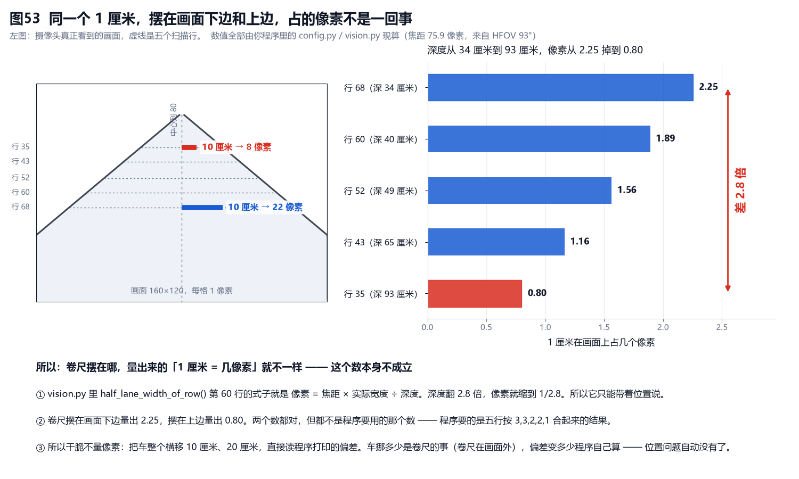

# 视觉 ↔ 电控链路：只保留能验的部分

> ## ⚠️ 2026-11-19 重要更正
>
> **本文档第 3 节里的扫描行表、半宽、车道宽度、帧率，全部已被 2026-11-18 的现场实测推翻。**
>
> **现行参数一律以 `明天现场流程与交接.md` 为准**：
> 车道半宽 **20 cm**（不是 27.5）、摄像头高度 **18.0 cm**（不是 20）、
> 帧周期 **26 ms**（不是 52）、扫描行 **129/113/98/81/75/71/67/64/62**（不是 136/120/…）、
> 九行、ROI 窗口、配对改成挑最近间距。
>
> 本文档保留下来的是**方法**（怎么算、为什么这么算），不是具体数字。

> **2026-11-18 重写。** 上一版建了一整套以「车头角 ψ」为核心的模型（偏差三项式、0.573 秒提前量、
> 阻尼比、相位裕度、最小转弯半径）。**ψ 程序测不到，跑动中也没法测**，所以整套删了。
>
> 这份文档只剩三样东西：
> 1. **代码里能对上的事实**（不依赖任何假设）
> 2. **一个换算系数**（1 厘米 ≈ 1.70 像素，算出来的，不进程序）
> 3. **Kp 的试凑规则**（不给数值，只给起点和方向）
>
> 每个数都标了来源类型：
> 【代码】程序里写死的 ／【量】拿工具测的 ／【估】估算，有误差 ／【待量】还没量

---

## 1. 链路事实（全部是代码事实）

| # | 环节 | 代码 | 进 → 出 | 来源 |
|---|---|---|---|---|
| ① | 找线 | `vision.py` `find_lane()` | 一张 160×120 灰度图 → 偏差（整数像素） | 【代码】 |
| ② | 拍板 | `judge.py` `decide()` | 偏差 → 误差(int8) + 状态(0/1/2/3) | 【代码】 |
| ③ | 发送 | `main.py` `send_frame()` | 两个数 → 4 字节 `AA e st 55` | 【代码】 |
| ④ | 接收 | `ReceiverK210.c` + `Protocol.c` | 逐字节状态机 → `data_ready = 1` | 【代码】 |
| ⑤ | 取帧 | `Service.c` `ServiceTask_30ms()` | 有标志才往下算，没有就 `return` | 【代码】 |
| ⑥ | 方向环 | `PID.c` `PID_L_Calc()` | 偏差 → 差速 `turn` | 【代码】**现在 Kp=Kd=0** |
| ⑦ | 分速度 | `Service.c` `Task_CalculateTargetSpeed()` | 左 = 基速 + turn，右 = 基速 − turn | 【代码】 |
| ⑧ | 速度环 + 电机 | `PID.c` `PID_V_Calc()` + `Motor.c` | 目标轮速 → 占空比 → 真轮速 | 【代码】 |

**这一圈有多久，是估算，不是模型：**

```
等下一帧（平均 26、最坏 52）【估】
+ 找线处理（约 12）         【估，明天会打出来】
+ 等 30 毫秒节拍（平均 15） 【代码 + 算术】
+ 速度环 + 电机（约 25）    【估】
≈ 平均 78 毫秒
```

---

## 2. 程序到底输出什么（别再往里加东西）

每帧就这些，一个不多：

| 输出的量 | 单位 | 说明 |
|---|---|---|
| `error` | 整数像素 | 五行加权平均（权重 3,3,2,2,1）的「车道中心列 − 80」 |
| `far_error` | 整数像素 | 最远两行的加权平均 |
| `found_row_count` | 个 | 有几行找到了线 |
| `bar_row_count` | 行 | 疑似横线的行数 |
| `far_found_row_count` | 行 | 最远两行里找到几行 |
| `corner_signal` | 0/1 | 弯道信号 |
| 每行的单线标记 | 0/1/2/−1 | 两条都在 / 只剩外侧 / 只剩内圈 / 没线 |

**程序里没有、也不该假设有的量：**

- 车头角（车相对赛道歪多少）
- 车心离车道中心多少米
- 横向速度
- 曲率半径

**这些量没人测得到**：没有陀螺仪，程序也不会对偏差求导。所以任何靠它们算出来的东西都不能用。

---

## 3. 换算系数：1 厘米 ≈ 1.70 像素（算的，不用量，也不用来定 Kp）

> **先纠正一件事：没有「1 厘米等于几像素」这个数。**
>
> 同一个 1 厘米，摆在画面下边占 2.25 像素，摆在上边只占 0.80 像素 —— **差 2.8 倍**。
> 式子写在 `vision.py` 第 60 行：**像素 = 焦距 × 实际宽度 ÷ 深度**。深度翻倍，像素减半。
> 所以卷尺摆在画面哪个高度，量出来的数就不一样；三个数都对，但**都不是程序要用的那个**。



| 行号 | 轴向深度 | 车前距离 | 半车道宽 | 1 厘米 = ? 像素 |
|---|---|---|---|---|
| 68 | 33.8 cm | 27.5 cm | 62 px | **2.25** |
| 60 | 40.0 cm | 34.6 cm | 52 px | 1.89 |
| 52 | 48.9 cm | 45.0 cm | 43 px | 1.56 |
| 43 | 65.3 cm | 63.9 cm | 32 px | 1.16 |
| 35 | 93.1 cm | 96.0 cm | 22 px | **0.80** |

焦距 **75.9 像素** = 半宽 80 ÷ tan(93° ÷ 2)【代码】。93° 这个视场角本身是【待量】。

**这个系数可以直接算出来**：五行按 3,3,2,2,1 合起来，

```
(3×2.25 + 3×1.89 + 2×1.56 + 2×1.16 + 1×0.80) ÷ 11 = 1.70 像素/厘米
```

**【代码 + 算术】**，不用拿尺子量。

### 它不进程序，也不用它定 Kp

程序里从头到尾只有 `turn = Kp × 偏差`，单位是 counts/像素，**一个厘米都没有**。
1.70 唯一的用处：把打印的像素数翻译成厘米，让你心里有个数 —— 偏差 20 像素 ≈ 12 厘米。

**定 Kp 不用换算。** Kp 直接试凑更快，起点在第 5 节给，什么量具都不用。

误差有多大关系：

| 误差来源 | 折成多少 | 要不要管 |
|---|---|---|
| 横移量尺子读错 1 厘米 | 5% | 不管 |
| 车摆歪 1 度 | 1.33 像素 ≈ 0.8 厘米 | 不管 |
| 视场角其实不是 93° | 系数差 1.8 倍 | 只影响"20 像素有多大"这个印象，不影响程序 |

歪 1 度 = 1.33 像素：75.9 像素 × 1 度的弧度值 0.01745 = 1.33，而且**五行都一样**
（远处横向偏移变大、每厘米的像素数变小，正好抵消）【算术】。

### 不用量、但值得花 5 秒看的两件事（跟 Kp 无关）

**① 看「实 / 理」两列** —— 验 `config.py` 里那三个【估】的安装参数（高度 20 厘米、低头角 30°、视场角 93°）。
它们决定扫哪五行，也决定只剩一条线时中心往哪推。

| 看到什么 | 结论 |
|---|---|
| 五行都有，\|实 − 理\| ≤ 3 像素 | 三个参数对得上 |
| 差 10 像素以上 | 参数错了，先量真实高度和低头角 |
| 某行「实」是 0 或者没有 | 那行只剩一条线，不是参数问题 |

> 看最开始那几块：程序每组把「理」往「实」挪 1/16（`live_scan_test.py` 第 180 行），
> 看久了它自己会收敛，参数错了也会被吃掉。

**② 推一把看方向** —— 车横着往左推 5 厘米，偏差应该**变大**。
反了就是 `HORIZONTAL_MIRROR` 或 `VERTICAL_FLIP` 填错，先去改那两个。

### 这一节砍掉了什么

| 砍掉的 | 为什么 |
|---|---|
| 卷尺标定：车横移 0/10/20 厘米、读五次偏差 | 这个数不进程序；只为定 Kp 的话，直接试凑更快 |
| 在地上画一条横线当基准 | 比赛场地不许画 |
| 用轮子判车身平不平行 | 前轮是万向轮，会自己转，不是固定参照点 |

---

## 4. 节拍：19.2 帧是怎么被推翻的（已解决）

【全部实测，2026-11-18】

### 4.1 原来以为的死路

- 相机最快 19.2 帧/秒 → **52.08 毫秒一张**
- 外环 `ServiceTask_30ms` 每 30 毫秒看一次，没新数据就 `return`
- 两个数一对：这一拍有新帧的概率 27%，没有 73%
- 所以方向环不是 33 次/秒，是 **16.7 次/秒**，间隔在 30 和 60 毫秒之间跳

### 4.2 实测推翻了两件事

**① 帧周期和像素多少无关，是两个固定档**

| 分辨率 | 帧率 | 一帧 |
|---|---|---|
| 80×60 / 160×120 | 19.23 | 52.0 ms |
| **320×240 / 640×480** | **38.46** | **26.0 ms** |

640×480 的像素是 320×240 的 4 倍，帧率一模一样 —— 说明卡的不是"读多少像素"。
`freq=27MHz`、`set_framerate(60)`、`dual_buff` 单独用，都改不动这 19.2。

**② 19.2 是单缓冲造成的，不是相机的能力**

| 条件 | 帧率 |
|---|---|
| 单缓冲 + 不处理 | 38.46 |
| **单缓冲 + 每帧处理 20 ms** | **19.23** |
| **双缓冲 + 每帧处理 20 ms** | **38.46** |

处理的那 20 毫秒里缓冲区被占着，DMA 接不上下一帧，只能隔帧拿。
**`sensor.reset(dual_buff=True)` 就能救回来。**

### 4.3 现在的结论

| 项 | 值 | 来源 |
|---|---|---|
| 分辨率 | 320×240 | 【代码】`sensor.set_framesize(sensor.QVGA)` |
| 帧周期 | **26.0 ms** | 【量】 |
| 每帧处理（9 行） | 22 ~ 23 ms | 【量】`live_scan_test` 打印的"用时" |
| 外环 | 30 ms 一拍，**每拍都有新数据** | 【算术】26 < 30 |

**外环间隔从"30/60 跳"变成恒定的 30 毫秒。** 后果：

1. **Kd 的门槛去掉了**：`err − err_last` 没除以时间这个毛病，在 dt 恒为 30 毫秒时不再致命。
   但 `PID.c:124` 的另外两条（噪声、死区造跳变）还在，见第 7 节 5b / 5c。
2. **断线保护宽了**：`lostdata_time > 3` = 4 拍 = 120 毫秒，现在是 **4.6 帧**而不是 2.3 帧。
3. **30 毫秒节拍成了新瓶颈**：相机能给 38.5 帧，外环只取 33 次。改成 10 毫秒节拍或事件驱动还能再拿 15%。

### 4.4 代价：曝光时间被砍半

26 毫秒一帧，最长只能曝光 26 毫秒；52 毫秒一帧时能曝 52 毫秒。
**场地暗的话画面会明显变噪。** 这一条只能在现场用同一副画面比较两种分辨率的「亮」值来判断。

---

## 5. Kp 怎么给（没有模型，只有规则）

**先说清楚：没有任何模型能算出 Kp 的数值。**

Kp 的作用只有一个：把"偏差多少像素"换成"差速多少 counts"。

```
turn = Kp × 偏差         单位：counts/5ms
左轮 = 基速 + turn，右轮 = 基速 − turn
```

### 起点怎么选：0.13 ~ 0.25（不用量任何东西，但要知道哪个轮子在发力）

**先看方向**：`左 = 基速 + turn，右 = 基速 − turn`。

- **turn > 0（右弯）→ 左轮加速** → 卡的是**左电机**
- **turn < 0（往左修）→ 右轮加速** → 卡的是**右电机**

赛道是三个右弯，所以**拐弯靠左轮**。换掉右电机不会增加拐弯的力量，它增加的是"往左修"的力量和直道速度。

| 事实 | 值 | 来源 |
|---|---|---|
| 直道基速 | 25 counts/5ms | 【代码】`Service.c:44` |
| 右电机上限 | **37**（≈1.04 米/秒空载） | 【用户实测】两边都换新电机后 |
| 左电机上限 | **37**（≈1.04 米/秒空载） | 【用户实测】 |
| 弯道顶 | 40 像素 | 【代码】`config.py:40` |

余量 = 上限 − 基速。**2026-11-18 晚基速改成 30**，余量从 12 掉到 7：

| 方向 | 余量 | Kp 起点 = 余量 ÷ 40 |
|---|---|---|
| 右弯（左轮加速） | 37 − 30 = **7** | **0.175** |
| 往左修（右轮加速） | 37 − 30 = **7** | **0.175** |

> 基速 25 时余量 12、Kp 起点 0.30；改成 30 之后**差速能力从 48% 掉到 23%**。
> 这是拿转向力量换直道速度，不是白拿的。

**合理区间 0.09 ~ 0.175（起点取 0.15）**：

| 边界 | 会出现什么 |
|---|---|
| Kp < 0.09 | 偏差到 80 像素也给不满 7 counts，车几乎不拐 |
| Kp ≈ 0.175 | 偏差 40 像素（≈24 厘米）打满，正好配上弯道顶 40 |
| Kp 再大 | 打满得更早，差速更早顶到电机上限 → 开关控制。真正的上限只有跑一圈才知道 |

> 这几个数只是起点，真值只有跑一圈才知道。
> 注意它和 `CORNER_TURN_BIAS_PX = 40` 是绑在一起的：只有 Kp × 40 = 余量 时，那个 40 才正好是"打满"。
> Kp 改成别的值，40 就不再是打满，两个得一起调。

### 怎么试

| 现象 | 动作 |
|---|---|
| 直道左右摆头、越摆越大 | Kp 减半 |
| 进弯往外冲、回不来 | Kp 加倍 |
| 完全没反应 | 先确认 Kp 不是 0（蓝牙 0x05 发过没有、断电没有） |

**一次只改一个数，改完跑一圈，看串口打印的偏差是收敛还是发散。**

### Kd

- **还是先给 0**，但理由变了。原来是不行，现在是"轮不到它"。
- 第 4 节说过：换成 320×240 后外环间隔恒为 30 毫秒，`err − err_last` 没除以时间这件事不再是致命伤。
- 但第 7 节 **5c** 还在：死区 `|偏差| ≤ 3` 在 PD 之前，偏差一跨进死区，D 项就看到一个假的负跳变。
  **这一条不解决，Kd 非 0 就自己抖。**
- 所以顺序是：先改死区的位置（挪到 PD 之后），再试 Kd。不改就一直是 0。

---

## 6. 差速与轮速（单位换算，几个数待量）

| 量 | 值 | 来源 |
|---|---|---|
| 编码器 | 1456 counts/转 | 【待量】核对电机型号（13 线 ×4 × 减速比 28） |
| 轮子周长 | 0.2042 米 | 【待量】量直径（现在按 65 毫米） |
| 1 count/5ms | 0.02805 米/秒 | 上面两个算的 |
| 三个基速 | **0.84** / 0.56 / 0.42 米/秒 | 30/20/15 × 0.02805 |
| 电机上限 | **两边都 37**（≈1.04 米/秒空载） | 【用户实测】两边都换新电机后 |
| 轮距 | 0.13 米 | 【待量】 |

**内环（5 毫秒 PI）：2026-11-18 台架调定 Kp=100、Ki=10**【代码 + 实测】

- **积分时间 = 100 × 0.005 ÷ 10 = 50 毫秒**
  电机的机械时间常数实测约 **39 毫秒**（从 0 爬到极限 37 的 97% 用了 140 ms = 3.6τ）。
  积分时间取 50 ms，比对象略慢，所以**不过冲**。
  之前 Ki=14（Ti=35.7 ms）时过冲 3~4 counts，降到 10 就没了。
- 误差到 **10 counts**，占空比就打满 1000‰
- **过冲 0、稳态误差 0、稳态纹波 ≤1 count**
- **加速慢、刹车快，改不掉**：加速时扭矩 ∝ (V − 反电动势)、刹车时 ∝ (V + 反电动势)。
  在 30 counts（37 的 81%）处两者差 **9.5 倍**，实测上升 55 ms / 下降 25 ms；
  正常工况（13↔25）是 27 ms / 12 ms，都在一个外环周期内。
  这是电机物理，不是参数问题。

---

## 7. 这条链路现在的问题清单

### 严重

| # | 问题 | 在哪 | 后果 |
|---|---|---|---|
| 1 | 方向环 Kp = Kd = 0 | `Service.c:77` | 车不拐弯 |
| 2 | 弯道顶 40 与 Kp 不匹配 | `config.py:40` | Kp 一加上来，40 会把方向打满 |

### 中等

| # | 问题 | 在哪 | 后果 |
|---|---|---|---|
| 3 | ~~外环 30 毫秒 ≠ 帧 52 毫秒，间隔在 30/60 跳~~ **已解决** | `Service.c:117` | 换成 320×240 后帧 26 毫秒，每拍都有新数据，间隔恒定 30 毫秒（见第 4 节）|
| 4 | ~~`lostdata_time > 3` 只有 1.3 帧余量~~ **已缓解** | `Service.c:286` | 现在是 4.6 帧余量（120 毫秒 ÷ 26 毫秒）|
| 5 | `turn` 限幅 ±25，是硬件余量（10~12）的 2 倍多 | `Service.c:330` | **等于没限幅**，真正卡住的是电机，一卡死就变开关控制 |
| 5b | Kd 没除以时间：`Kd × (err − err_last)` | `PID.c:124` | 换成 320×240 后 dt 恒为 30 毫秒，这条**不再是致命伤**；但下面 5c 还在 |
| 5c | 死区在 PD **之前**，把 \|偏差\| ≤ 3 掐成 0 | `Service.c:308` | 偏差跨过 ±3 时 D 项看到假的 −4 跳变，自己造出 ±4 的抖动 |

### 轻微

| # | 问题 | 后果 |
|---|---|---|
| 6 | 死区 `fabsf(error) <= 3` | 按 1.70 换算 ≈ 1.8 厘米，本来很小；但只要 Kd ≠ 0 就变成坑（见 5c） |
| 7 | `error` 夹 ±127 永远执行不到（实际 ±80） | 无害 |
| 8 | 状态 3 永远发不出来（`FINISH_LINE_ENABLE = False`） | 比赛要自己按停 |
| 9 | 弯道信号只认右弯 | 镜像赛道不触发 |
| 10 | 串口没有校验 | 极低概率用一帧错数据 |

---

## 8. 这一版删掉了什么（以及为什么）

| 删掉的 | 为什么删 |
|---|---|
| 偏差三项式 `e = −Gx − Hψ + C/R` | ψ 测不到；C/R 假设赛道有圆弧，实际是折线 |
| 0.573 秒提前量、0.401 米等效看远距离 | 靠 ψ 推的 |
| 阻尼比 0.79、相位裕度 49° 这些数 | 靠上面那些推的，一步比一步远 |
| "Kp 0.1～0.3""Kd 0.1 提 9 度相位" | 仿真出来的数，不是测的 |
| 最小转弯半径 0.325 米 | 赛道是折线，没有半径可跟 |
| 图43 / 图45 / 图46 / 图48 / 图50 / 图51 / 图52 | 画的都是上面这些 |

**留下的每一句，要么是代码里写着的，要么是拿尺子能量出来的。**
