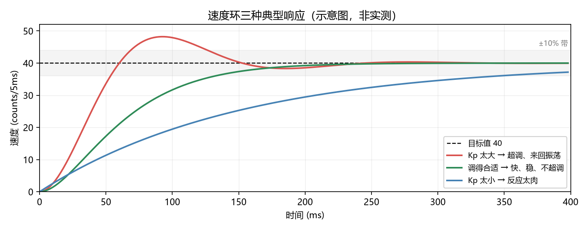

# 调参记录

> 用途：记录每一组参数 + 现象 + 结论，避免"调了半天不知道哪组最好"。
> 相关文件：`Control/AppLayer/Service.c`（STM32 参数）、`Visual/config.py`（K210 参数）

---

## 一、为什么不要每次都 git

你的判断是对的。原因很实在：

| | git 每次提交 | 本文档记录 |
|---|---|---|
| 一次操作成本 | 写 commit message、add、commit | 抄一行字 |
| 适合的粒度 | **里程碑** | **每次试验** |
| 调 30 组产生 | 30 个 commit，`git log` 全废 | 30 段文字，随时翻 |
| 出问题回退 | 强（能精确还原） | 弱（靠文档抄回去） |

**结论：试验用文档记，里程碑才 git。**

一天调 30 组参数 → 文档里 30 段；只提交 2~3 次（早上能跑的一组、下午调好的一组）。

> ⚠️ **不要用 git 分支试参数。** 切来切去、合并冲突，会让你怀疑人生，
> 而且对"手抄几个数字"这件事来说完全是杀鸡用牛刀。

---

## 二、这个方案怎么用

### 2.1 三条铁律

| # | 铁律 | 为什么 |
|---|---|---|
| 1 | **一次只改一个参数** | 改两个就不知道是哪个起作用，等于白调 |
| 2 | **先写"预期"再跑，跑完补"实际"** | 逼自己想清楚"我为什么要改这个" |
| 3 | **每组参数都写全，不只写改动** | 只写"Kp 0.05→0.08"，过两天就不知道当时其他参数是多少了 |

### 2.2 参数总共只有 16 个，一行能写完

不用费劲搞快照、搞脚本，**手抄一遍也就 30 秒**。

| 来源 | 参数 | 个数 |
|---|---|---|
| STM32 | 速度环 Kp/Ki（左右各一组）、方向环 Kp/Kd、三个基础速度 | 9 |
| K210 | `CALIB_OFFSET`、`CURV_T1/T2`、`CORNER_BIAS`、`SMOOTH_SHIFT`、`LOST_KEEP` | 7 |

### 2.3 每组记录的格式

复制下面这段，改数字就行：

```
### T__ · __/__ __:__ · 电池 __._V · 场地 ______

改动：__________________________________________
STM32：vL Kp/Ki=__/__ · vR Kp/Ki=__/__ · line Kp/Kd=__/__ · 速 __/__/__
K210 ：CALIB=__ · T1/T2=__/__ · CORNER=__/__ · SMOOTH=__

预期：__________________________________________
现象：__________________________________________
结论：__________________________________________
```

### 2.4 别忘了记这三样"非参数"

| 记什么 | 为什么 |
|---|---|
| **电池电压** | 电压从 12.6V 掉到 11.5V，同样参数下速度会明显变慢，现象会骗人 |
| **场地** | 地板 / 瓷砖 / 白天晚上，光照直接影响视觉阈值 |
| **时间** | 回头翻记录时能对上"那天下午那次" |

---

### 2.5 波形图怎么放进去（可选，但答辩很有用）

Markdown 支持插图，一行引用就行：

````markdown

````

**三步**：

1. 在 VOFA+ 里把波形调到好看（横轴时间、纵轴速度），按 `Win + Shift + S` 截图
2. 存成 `Doc/图片/T07_速度环阶跃.png`（编号和那条记录对齐）
3. 在那条记录的末尾加一行 ``

**命名规则**：`T编号_内容.png`，比如 `T07_速度环阶跃.png`、`T12_入弯误差.png`。
图片编号和记录编号对上，翻起来才不会乱。

> 图片要跟着文档一起提交，否则换台电脑或推到远程就显示不出来了。

#### 该看什么波形

| 想调什么 | 看哪两个信号 | 判断依据 |
|---|---|---|
| 速度环 `Kp` / `Ki` | 目标速度 vs 实际速度 | 追不上 = `Kp` 太小；冲过去再回来 = `Kp` 太大 |
| 方向环 `Kp` | `error` | 误差长期偏一边回不到 0 = 转向不够 |
| 方向环 `Kd` | `error` | 误差反复正负抖动 = `Kd` 不够，或太大引起振铃 |

VOFA+ 现在发的是 5 个通道：

| 通道 | 内容 | 变量 |
|---|---|---|
| 0 | 左轮目标速度 | `target_left` |
| 1 | 左轮实际速度 | `actual_left` |
| 2 | 右轮目标速度 | `target_right` |
| 3 | 右轮实际速度 | `actual_right` |
| 4 | 视觉误差 | `error` |

#### 三种典型响应长什么样



| 曲线 | 含义 | 该怎么办 |
|---|---|---|
| 🔴 红色 | 超调、来回振荡 | `Kp` 或 `Ki` 太大，降一点 |
| 🟢 绿色 | 快、稳、略微过冲就回落 | **这就是目标** |
| 🔵 蓝色 | 慢慢爬、追不上目标 | `Kp` 太小，加一点 |

> 这张是**示意图，不是实测数据**，用来说明"好"和"不好"长什么样。

#### 想要更清楚的图

截图有窗口边框、分辨率也受屏幕限制。如果要做报告或者多组对比：

- 把 VOFA+ 导出的数据（或者串口收到的原始数据）丢给我
- 我用统一风格画一张，可以**把好几组参数叠在同一张图上对比**
- 图的字体、配色、坐标范围都能统一，放进报告里好看得多

---

## 三、参数全表（抄的时候对着这张）

### 3.1 STM32 侧（`Service.c`）

| 参数 | 代码位置 | 默认值 | 含义 | 蓝牙指令码 |
|---|---|---|---|---|
| 左轮速度环 `Kp` | `Service_Init()` | 0 | 转速跟随快慢 | `0x01` |
| 左轮速度环 `Ki` | `Service_Init()` | 0 | 消除稳态误差 | `0x02` |
| 右轮速度环 `Kp` | `Service_Init()` | 0 | 同上 | `0x03` |
| 右轮速度环 `Ki` | `Service_Init()` | 0 | 同上 | `0x04` |
| 方向环 `Kp` | `Service_Init()` | 0 | 偏得越多掰得越狠 | `0x05` |
| 方向环 `Kd` | `Service_Init()` | 0 | 抑制甩尾/过冲 | `0x06` |
| `Speed_Straight` | 全局变量 | 40 | 直道基础速度 | `0x07` |
| `Speed_SmallAngle` | 全局变量 | 25 | 直角/钝角弯速度 | `0x08` |
| `Speed_LargeAngle` | 全局变量 | 15 | 锐角弯速度 | `0x09` |

调参范围限制（代码里写死的，超了不生效）：

| 参数 | 上限 |
|---|---|
| 速度环 `Kp` | 10.0 |
| 速度环 `Ki` | 10.0 |
| 方向环 `Kp` | 50.0 |
| 方向环 `Kd` | 100.0 |
| 三个基础速度 | 100.0 |

### 3.2 K210 侧（`config.py`）

| 参数 | 默认值 | 含义 | 什么时候改 |
|---|---|---|---|
| `CALIB_OFFSET` | 0 | 车摆正时的误差读数 | 静态验证第 2 步 |
| `CURV_T1` | 10 | 远处偏差 > 此值 → 状态 1 | 减速太早/太晚 |
| `CURV_T2` | 22 | 远处偏差 > 此值 → 状态 2 | 同上 |
| `CORNER_BIAS` | 40 | 确认右弯后顶到的误差 | 急弯过不去就加大 |
| `CORNER_TRIGGER` | 8 | 触发提前打方向的门槛 | 弯里反复触发就减小 |
| `SMOOTH_SHIFT` | 0 | 平滑档位（0/1/2） | 抖得厉害改 1 或 2 |
| `LOST_KEEP` | 10 | 丢线容忍帧数 | 一丢线就停就加大 |

> 完整参数表见 `Doc/视觉.md` 附录 A。

---

## 四、当前最佳（每次定稿后更新这里）

> 这张表是"现在车上跑的是什么"。调乱了先看这里。

| 项目 | 数值 | 来源试验 | 日期 |
|---|---|---|---|
| 速度环 `Kp` / `Ki` | __ / __ | T__ | __/__ |
| 方向环 `Kp` / `Kd` | __ / __ | T__ | __/__ |
| 基速 直/小/大 | __ / __ / __ | T__ | __/__ |
| `CALIB_OFFSET` | __ | T__ | __/__ |
| `CURV_T1` / `T2` | __ / __ | T__ | __/__ |
| `CORNER_BIAS` / `TRIGGER` | __ / __ | T__ | __/__ |
| `SMOOTH_SHIFT` | __ | T__ | __/__ |
| 已知问题 | | | |

---

## 五、试验记录

> 从 T01 开始往下写，新的写在最上面还是最下面都行，**但要坚持一种**。

### T00 · __/__ __:__ · 电池 __._V · 场地 ______（示例，可以删）

```
改动：初值，全默认
STM32：vL 0.6/0.15 · vR 0.6/0.15 · line 0.05/0.3 · 速 40/25/15
K210 ：CALIB 7 · T1/T2 10/22 · CORNER 40/8 · SMOOTH 0

预期：直道应该能走，弯道可能会冲出去
现象：直道走得直，进第一个弯直接冲出赛道
结论：转向量不够。下次不动别的，只把 line Kp 从 0.05 加到 0.08
```

---

## 六、踩过的坑（避免重复踩）

> 每条一行：**现象 → 原因 → 怎么解决**。解决了就划掉但别删。

| 日期 | 现象 | 原因 | 解决 |
|---|---|---|---|
| | | | |

---

## 七、里程碑与 git

### 7.1 什么时候提交

只在下面这些时刻提交，**不要每次试验都提交**：

| 时机 | commit message 示例 |
|---|---|
| 找到第一组"能完整跑一圈"的参数 | `tune: T12 first full lap, Kp=0.08 Kd=0.35` |
| 明显更快/更稳的一组 | `tune: T18 单圈 12.4s, 中弯不再甩尾` |
| 比赛前定稿 | `tune: T25 final for competition` |
| 改完参数并写回代码 | `tune: apply T18 gains to Service.c defaults` |

### 7.2 提交时把参数写进 message

因为 `git log` 只有 message 能看，把关键数字写进去，
以后 `git log --oneline` 一眼就能看到"哪次提交是哪组参数"。

```bash
git commit -m "tune: T18 vKp=0.6 LKp=0.08 LKd=0.35 speed=45/28/18"
```

### 7.3 打完标签

比赛前定稿那次，打个 tag：

```bash
git tag -a v1.1.0-competition -m "T25 final: LKp=0.08 LKd=0.35 speed=45/28/18"
```

---

## 八、一个必须知道的坑

> **STM32 通过蓝牙改的参数只存在内存里，一断电就全回到 `Service.c` 里的默认值。**

所以流程永远是：

```
蓝牙试参数 → 找到好的一组 → 抄进本文档 → 写回 Service.c → 重新编译烧录 → 才算真正定下来
```

**中断试验前（比如收工、换电池），先把屏幕上那组数抄下来。**
不然一断电，一下午的成果就没了。

---

## 九、一张图记住整个流程

```
        ┌─────────────────────────────────┐
        │  改一个参数（只改一个！）          │
        └───────────────┬─────────────────┘
                        ▼
        ┌─────────────────────────────────┐
        │  跑车，看现象                     │
        └───────────────┬─────────────────┘
                        ▼
        ┌─────────────────────────────────┐
        │  写进本文件（T编号 + 全参数 + 结论）│
        └───────────────┬─────────────────┘
                   ┌────┴────┐
              有进步？        没进步？
                   │            │
                   ▼            ▼
          更新"当前最佳"      记一笔就翻篇
                   │
                   ▼
             够好了吗？──是──→ 写回代码 + git 提交 + tag
                   │
                   否
                   │
                   └──→ 回到第一步
```
